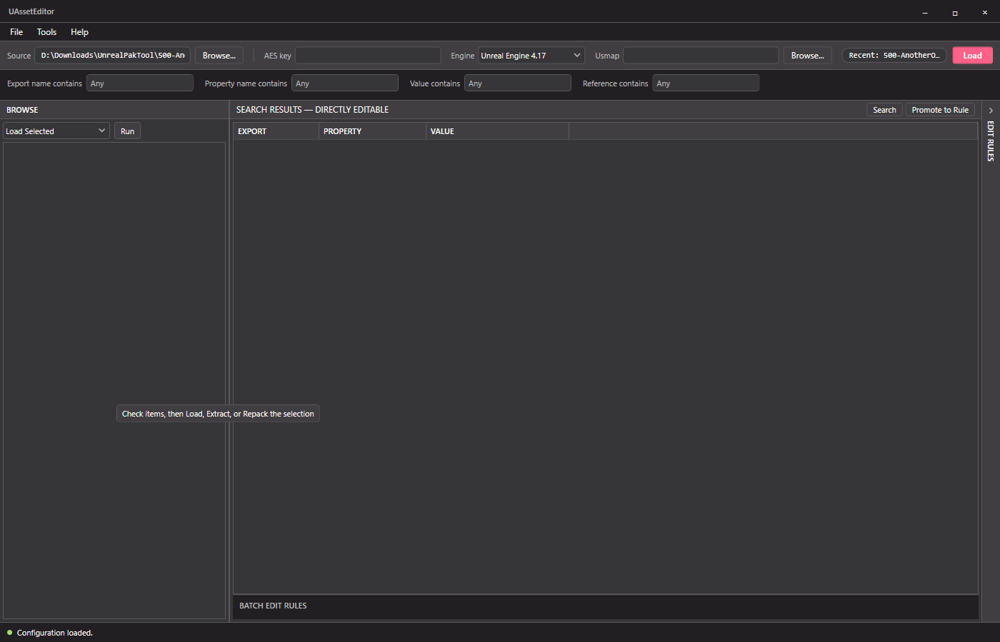

# UAssetEditor

An editor for .pak and .uasset files.



## Build

Requires the exact .NET SDK pinned in `global.json` (11.0.100; no roll-forward, because each SDK patch changes the trimmer package recorded in the lock files).

```
dotnet build UAssetEditor.slnx
```

Run the test suite (Release matches what CI runs):

```
dotnet test tests/UAssetEditor.Core.Tests/UAssetEditor.Core.Tests.csproj -c Release
dotnet test tests/UAssetEditor.App.Tests/UAssetEditor.App.Tests.csproj -c Release
dotnet test tests/UAssetEditor.Mcp.Tests/UAssetEditor.Mcp.Tests.csproj -c Release
```

## Run

For development, run straight from source:

```
dotnet run --project src/UAssetEditor.App
```

For a standalone build, publish the single-file executable:

```
dotnet publish src/UAssetEditor.App/UAssetEditor.App.csproj -p:PublishProfile=SingleFileRelease
```

The result is a single self-contained `UAssetEditor.App.exe` under `src/UAssetEditor.App/bin/Release/net11.0-windows/publish/win-x64/` - no separate .NET runtime install needed on the target machine.

### Where files go

| What | Default location | Override |
|---|---|---|
| Logs (the MCP server's in `Logs\Mcp`), and the retoc and pak worker executables the app extracts on first run (all rebuildable) | `%LOCALAPPDATA%\UAssetEditor\Logs` and `...\Tools` (`$XDG_CACHE_HOME/UAssetEditor` on Linux) | `UASSETEDITOR_CACHE_DIR` |
| Stored usmaps | `%LOCALAPPDATA%\UAssetEditor\Mappings\<game>` | `UASSETEDITOR_MAPPINGS_DIR` |
| The last session (source path, settings) | `%LOCALAPPDATA%\UAssetEditor\lastSession.json` | none |

Pak extractions for editing and IoStore repacking use the system temp folder and are removed when the pak is closed or the repack ends. Nothing is written next to the executable.

### Oodle-compressed paks

Some older Unreal 4 games (Days Gone) compress their `.pak` entries with Oodle, a proprietary library by Epic Games Tools (RAD) that this project does not include or distribute. Reading those entries needs your own copy of the 64-bit `oo2core_<n>_win64.dll`, found in this order:

1. `REPAK_OODLE_DLL`, set to the full path of the DLL (in the app, the CLI or the MCP server's environment).
2. A copy in the game's install. Starting at the pak's folder, up to five parent folders are examined for the game's root (a folder with an `Engine` folder or a `.uproject`, or whose child on the way to the pak is a project folder with `Content` and `Binaries\Win64`; never a drive root). A DLL next to a loose pak that is not inside such a game folder is not found: use `REPAK_OODLE_DLL` for it. The search stops at that root and looks only inside it: the root itself, `Engine\Binaries\ThirdParty\Oodle\**` and `<project>\Binaries\Win64`. The highest version found wins. It runs when an entry read first needs Oodle, not when a pak is opened.

Only a file named `oo2core_<n>_win64.dll` is accepted, and neither `PATH` nor the working folder is searched by this app. A `REPAK_OODLE_DLL` that is not a full path to such a file is an error, never passed on to the pak worker. Many games link Oodle into their executable and ship no DLL (Days Gone and Marvel Rivals do not); take it from another Unreal game that does ship one (for example Final Fantasy VII Remake keeps `oo2core_7_win64.dll` under `Engine\Binaries\ThirdParty\Oodle\Win64`) and point `REPAK_OODLE_DLL` at it. Without a DLL, opening an Oodle entry fails with "Oodle DLL not found. Point REPAK_OODLE_DLL at the game's oo2core_*_win64.dll."

See [`docs/ARCHITECTURE.md`](docs/ARCHITECTURE.md) for the non-obvious design decisions behind the pak worker process, retoc integration, and a few other things that aren't visible just from reading the code top to bottom.

## MCP server

`UAssetEditor.Mcp` is a local [MCP](https://modelcontextprotocol.io) server (stdio) that lets an agent read and edit assets and archives. It runs the same Core code as the app and `uacli` in one long-lived process, so an agent batches every op for an asset into one call instead of starting a process per edit. Logs go to `UASSETEDITOR_CACHE_DIR/Logs/Mcp` (14 days kept), never to standard output; `UASSETEDITOR_MCP_LOG_LEVEL` (`Information`, `Warning`, `Error`) sets the level.

Install: publish the single-file executable, put it wherever the client can start it, and register that path as a stdio server with no arguments.

```
dotnet publish src/UAssetEditor.Mcp/UAssetEditor.Mcp.csproj -c Release -r win-x64 -o src/UAssetEditor.Mcp/publish
```

```json
{ "mcpServers": { "uasseteditor": { "command": "C:/path/to/UAssetEditor.Mcp.exe" } } }
```

The bundled pak worker and retoc are embedded in the executable and extracted into the cache folder on first use, as for the app. `UAssetEditor.Mcp --version` and `--help` print and exit.

Tools that only read (marked read-only, so a client can pre-approve them):

| Tool | What it does |
|---|---|
| `list_exports`, `list_imports` | An asset's exports (optionally their declared members) and imports. |
| `get_tree` | Struct, array and map nodes under an export or property, to a depth. |
| `dump_export` | Every leaf property as path and value, scoped by path or filter, capped. |
| `search_assets` | Exports, properties, values or references in one asset or a folder, with progress. |
| `preview_edit` | Dry run of script ops (`set`, `duplicate`, `splice-node`, ...); never writes. |
| `preview_ruleset` | Dry run of a rule set over an asset or folder; never writes. |
| `pak_info`, `pak_list`, `iostore_list` | A `.pak`'s header and entries, a `.utoc`'s chunk paths. Windows only. |
| `usmap_list` | The stored usmaps, newest build first. |
| `game_log_summary` | A decoded Marvel Rivals log reduced to engine build, mods, hero ids and crash block. |

Tools that write (the client asks first). Every one that can replace something is marked destructive and refuses to unless told to:

| Tool | What it writes |
|---|---|
| `edit_asset` | Runs script ops. A dry run unless `save=true`, which overwrites the `.uasset`/`.uexp` after copying both to `.bak` (the files as they were before that save, replaced on each save) and, on the first save, to `.orig.bak` (the original, never replaced); `backup=false` skips both. It saves nothing when any op was skipped, and one call at a time runs per file. A line cannot set its own `--usmap`, `--version` or `--game`, and its `--from-file` must be an existing local `.uasset`. |
| `apply_ruleset` | Applies a rule set in place, with `.bak` and `.orig.bak` copies as for `edit_asset`; a failed asset is left unsaved and reported. |
| `unpack_pak` | Extracts entries matching a required `filter` (real game paks are tens of GB); refuses more than `maxFiles` matches or an existing file unless `overwrite=true`. Windows only. |
| `pack`, `to_legacy`, `repack` | Write a new `.pak`, `.utoc`/`.ucas` pair, legacy folder or `.pak`; refuse an existing output unless `overwrite=true`. `repack` never changes its source. Windows only. |
| `usmap_add` | Copies a dumped `.usmap` into the store; `force=true` replaces a stored build. |

Asset tools take `game` (`rivals`, `ff7r`, `stellarblade`), `engineVersion`, `usmap` and `strict` like the `uacli` global options; with a game and no `usmap` they use the newest stored one and say which. They run on any OS; the pak and IoStore tools need Windows and say so elsewhere. Paths must be absolute and local (network paths are refused). Names, values and log lines in results come from files that may be crafted, so they are cleaned, capped and described to the model as data; results carry a `truncated` flag when a cap applied. AES keys are accepted as input for non-game paks but never returned or logged.

## How this is different from UAssetGUI

UAssetGUI opens one .uasset at a time and you edit it by hand in a property tree. UAssetEditor is built around doing the same edit to a lot of assets at once, and working straight from the archive instead of unpacking everything first.

- **Search across a whole pak or folder, not one file.** Filter by export name, property name, value, or reference, and see every match from every asset in one results grid, editable right there.
- **Turn a search into a repeatable rule.** Set a value, adjust a number, find/replace text (regex supported), add or remove a tag, remove a property, or swap a reference, then preview the change and apply it across every matching asset at once instead of doing it by hand one by one.
- **Browse and act on pak/.utoc archives directly.** Check the files you want in the tree, then load, extract, or repack just those, without unpacking the whole archive to disk with a separate tool first. Large archives are handled a piece at a time so browsing a multi-gigabyte pak doesn't mean loading the whole thing into memory.
- **Handles encrypted paks and IoStore containers.** There's a spot for an AES key for encrypted paks, and .utoc/.ucas (IoStore) files are supported through a bundled converter.
- **Pick the game and it fills in the rest.** **Tools → Game** (`--game rivals|ff7r|stellarblade` in `uacli`) sets the engine version and the pak AES key for that game; an explicit engine version or key still wins. For Marvel Rivals the key is the one its IoStore containers use, also for `--aes` and the key field: a Rivals `.pak` is encrypted with that key's 4-byte words reversed, and the app does the reversal itself when it reads or writes one, so never type the reversed form. For Final Fantasy VII Remake it also shows the game's DataObject data tables as ordinary editable properties (rows, fields, arrays), so search, dump, set and batch rules work on them. Tables are saved back only when an edit keeps every value the same size; anything else is refused with a message naming the row and field, and nothing is written.
- **Marvel Rivals mods pack the way the community packer does.** With Marvel Rivals selected, packing a folder to `.utoc` produces the same container retoc-rivals' `pack` would, including its companion `.pak`. `uacli pack` can also port legacy KawaiiPhysics nodes and set meshes' default hidden materials on the way (`--kawaii-physics`, `--patch-default-hidden-mats`, `--default-hidden-material-bitmaps`), and obfuscate the container (`--obfuscate`), without touching the source folder.
- **Keeps the current usmap and reads the game's crash logs.** `uacli usmap add` stores each dumped Marvel Rivals usmap by game build, and `--game rivals` then picks the newest one (with a warning when the game has since been patched). After a patch, `uacli usmap diff` shows what the new schema changed and `uacli usmap triage <mod folder>` which of a mod's assets now read differently and need rebuilding. `uacli game-log --summary` decodes the game's encrypted log into its engine build, mounted mods and crash block, and `--diff` shows which mods differ from a session that worked.
- **Doesn't give up on an asset just because part of it is broken.** If something in an asset fails to parse, UAssetEditor keeps what it can read (header, names, other exports) instead of refusing to open the file at all. Running a batch edit over many assets also tells you which ones failed instead of silently skipping them or aborting the whole run.
- **A crash in the pak reader doesn't take the app down with it.** Pak reading and writing runs in its own worker process, so a bad entry can fail without losing your session.
- **Never touches your original file.** Edits are written out to a new pak, so there's nothing to undo if a batch edit goes wrong.
- **Pack and unpack pak files from the same window**, no separate command-line tool needed.

## License

MIT, see [LICENSE](LICENSE). Bundled and ported third-party code keeps its own licences, listed in [THIRD_PARTY_NOTICES.md](THIRD_PARTY_NOTICES.md).
